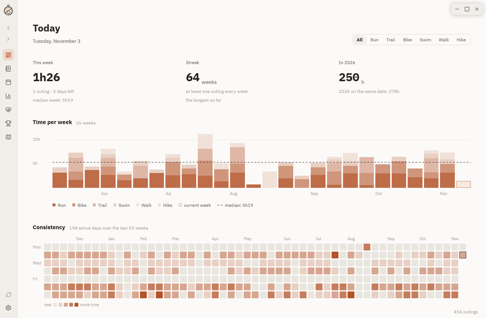

# Astrolabe

[](https://github.com/alarboulletmarin/astrolabe/actions/workflows/ci.yml)
[](https://github.com/alarboulletmarin/astrolabe/releases/latest)
[](LICENSE)

A desktop journal of your sport activities, read from your Garmin account. Your activities, their GPS tracks and their curves are kept on your machine, and the app opens instantly on what it has. Written in Rust with [GPUI](https://www.gpui.rs).



**[Install](#install)** · **[User guide](book/src/introduction.md)** · [Shortcuts](book/src/shortcuts.md) · [Website](https://alarboulletmarin.github.io/astrolabe/) · [Architecture](ARCHITECTURE.md) · [Contributing](CONTRIBUTING.md)

## Why Astrolabe

- **Yours.** Activities, tracks and curves are kept on your machine, in files only you can read. The app opens instantly on what it has, then synchronises in the background. [Your data](book/src/data.md)
- **Where you stand, not what to do.** This week against your median week, your records, your form: figures and how they are worked out, never advice.
- **Today**: this week against your median week, the run of active weeks, the year so far against the year before, six months week by week, a year day by day. [Guide](book/src/dashboard.md)
- **Journal**: every activity, week by week, with a search, a filter by sport and the columns you choose, down to the gap to your usual pace and the time in each heart rate zone. [Guide](book/src/journal.md)
- **Activity**: the map of the track, pace, heart rate and elevation curves pointing at each other, splits and laps. [Guide](book/src/activity.md)
- **Calendar**, **Statistics** (any measure, grouping, period and sports), **Form** (load, fatigue, freshness), **Records** (road, trail, cycling, swimming) and a **Heatmap** of all your tracks.
- **Loops**: click a start, ask for a distance, and get running or trail loops on OpenStreetMap's paths, with their climb, profile and a GPX file; GPX tracks from elsewhere can be imported. In 3D, the ground carries aerial photos in France. Computed on your machine once the region is downloaded. [Guide](book/src/loops.md)
- **Light and dark, English and French**, following your system.

An astrolabe is the old instrument of astronomers and sailors: you take the height of a star, read a scale, and know where you stand. Astrolabe does the same with your activities.

## Your data stay yours

- Activities and their files live in the app's data folder, readable by you only. Nothing goes anywhere but Garmin and the map tile server; and, for loops, Geofabrik and the elevation tile server, which never see your start or your loops, and in 3D the IGN's photo server, which sees the photo tiles along the route shown.
- The Garmin key goes to your system's keyring, or to a file the app encrypts itself where there is none. It is never written in the clear.
- Files are written whole or not at all; a damaged one is set aside, never thrown away.

## Install

| System | Get it |
|---|---|
| Arch Linux | the prebuilt package, below |
| macOS 11 or later | [`astrolabe-macos.dmg`](https://github.com/alarboulletmarin/astrolabe/releases/latest/download/astrolabe-macos.dmg) |
| Windows 10 or 11 | [installer](https://github.com/alarboulletmarin/astrolabe/releases/latest/download/astrolabe-windows-x86_64-setup.exe) or [zip](https://github.com/alarboulletmarin/astrolabe/releases/latest/download/astrolabe-windows-x86_64.zip) |
| Ubuntu, Debian, Fedora, other Linux | build from source, below |

```bash
# Arch Linux
curl -LO https://github.com/alarboulletmarin/astrolabe/releases/latest/download/astrolabe-x86_64.pkg.tar.zst
sudo pacman -U ./astrolabe-x86_64.pkg.tar.zst
```

```bash
# Other Linux: needs a recent stable Rust, and the libraries listed in the install guide
git clone https://github.com/alarboulletmarin/astrolabe.git
cd astrolabe
make && sudo make install
```

The macOS and Windows downloads are not signed. The first launch needs one extra click: see [the install guide](book/src/install.md), which also covers the libraries of each distribution, building on macOS and Windows, and upgrading.

Astrolabe does not check for updates yet: to update, install the new release over the old one ([how](book/src/updates.md)).

## Getting started

1. On the Garmin Connect website, create a key in **Account settings › Personal API key**.
2. Launch Astrolabe and paste the key in the settings. It is checked with Garmin, then the first synchronisation starts.
3. The list of your activities arrives in seconds; the file of each one follows in the background.

More in [First steps](book/src/first-steps.md). Something wrong? See [Troubleshooting](book/src/troubleshooting.md).

## Documentation

The [user guide](book/src/introduction.md) covers everything. It is also published as a website: [alarboulletmarin.github.io/astrolabe/guide](https://alarboulletmarin.github.io/astrolabe/guide/).

| Page | What it covers |
|---|---|
| [Navigation](book/src/navigation.md) | the rail, back and forward, the keyboard, the window |
| [Today](book/src/dashboard.md), [Journal](book/src/journal.md), [Calendar](book/src/calendar.md), [An activity](book/src/activity.md) | the home page, the table of outings, the days, one outing |
| [Statistics](book/src/stats.md), [Form](book/src/form.md), [Records](book/src/records.md), [Heatmap](book/src/heatmap.md) | measures over time, load and freshness, best efforts, all tracks on a map |
| [Planning loops](book/src/loops.md) | loops of a given length, their climb, a GPX file |
| [Synchronising](book/src/sync.md) | what a sync does, and what happens when it can't |
| [Your data and backups](book/src/data.md) | what is kept where, and how to copy it |
| [Settings](book/src/settings.md), [Updates](book/src/updates.md) | the key, the map, the theme; how to update |
| [Keyboard shortcuts](book/src/shortcuts.md) | every shortcut |
| [Compatibility](book/src/compatibility.md), [Troubleshooting](book/src/troubleshooting.md), [Performance](book/src/performance.md) | systems, every error message, measurements |

## Contributing

Bug reports and small fixes are welcome. For a feature, open an issue first. Read [CONTRIBUTING.md](CONTRIBUTING.md) and the map of the code, [ARCHITECTURE.md](ARCHITECTURE.md). Releases are described in [RELEASING.md](RELEASING.md). For a security problem, see [SECURITY.md](SECURITY.md).

```bash
cargo run              # debug build
cargo test --locked    # pure tests, the window on GPUI's test platform, sync flows against a stand-in for Garmin
scripts/demo-data.py /tmp/demo && XDG_DATA_HOME=/tmp/demo cargo run   # made-up data, no account
```

## License

[MIT](LICENSE). The IBM Plex fonts are under the [SIL Open Font License](assets/fonts/LICENSE-IBM-Plex.txt). Map data © [OpenStreetMap](https://www.openstreetmap.org/copyright) contributors, under the [ODbL](https://opendatacommons.org/licenses/odbl/). Elevation from [Mapzen Terrain Tiles](https://github.com/tilezen/joerd/blob/master/docs/attribution.md) (SRTM, Copernicus EU-DEM and others). Aerial photos of France in 3D from the [IGN](https://geoservices.ign.fr/bdortho) (BD ORTHO), under the [Licence Ouverte 2.0](https://www.etalab.gouv.fr/licence-ouverte-open-licence/).
