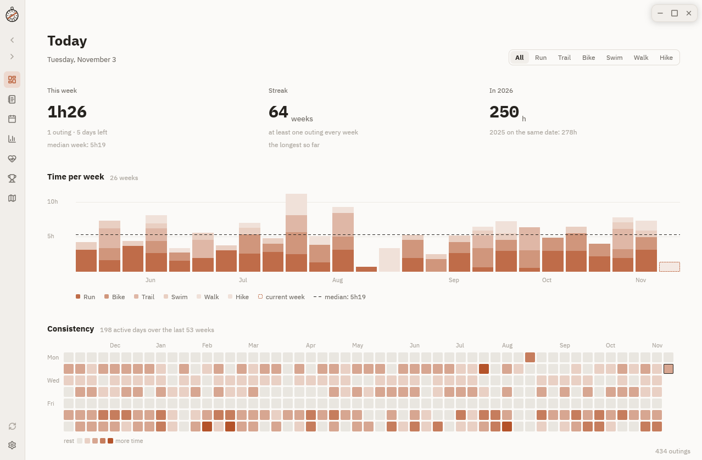

# Astrolabe

[](https://github.com/alarboulletmarin/astrolabe/actions/workflows/ci.yml)
[](https://github.com/alarboulletmarin/astrolabe/releases/latest)
[](LICENSE)

A desktop journal of your sport activities, read from your Garmin account. Your activities, their GPS tracks and their curves are kept on your machine, and the app opens instantly, online or not. Written in Rust with [GPUI](https://www.gpui.rs).



**[Install](book/src/install.md)** · **[User guide](book/src/introduction.md)** · [Shortcuts](book/src/shortcuts.md) · [Website](https://alarboulletmarin.github.io/astrolabe/) · [Architecture](ARCHITECTURE.md) · [Contributing](CONTRIBUTING.md)

An astrolabe is the old instrument of astronomers and sailors: you take the height of a star, read a scale, and know where you stand. Astrolabe does the same with your activities. It shows where you stand, without telling you what to do.

## What it shows

- **Today**: this week against your median week, the run of active weeks, the year so far against the year before, six months week by week, a year day by day.
- **Journal**: every activity, week by week, with a search, a filter by sport and the columns you choose, down to the gap to your usual pace and the time in each heart rate zone.
- **Activity**: the map of the track, pace, heart rate and elevation curves pointing at each other, splits and laps.
- **Calendar**, **Statistics** (any measure, grouping, period and sports), **Form** (load, fatigue, freshness, stated without advice), **Records** (road, trail, cycling, swimming) and a **Heatmap** of all your tracks.
- Light and dark, English and French, following your system.

The [guide](book/src/pages.md) describes each page.

## Your data stay yours

- Activities and their files live in the app's data folder, readable by you only, and work offline. Nothing goes anywhere but Garmin and the map tile server.
- The Garmin key goes to your system's keyring, or to a file the app encrypts itself where there is none. It is never written in the clear.
- Files are written whole or not at all; a damaged one is set aside, never thrown away.

More in [Your data and backups](book/src/data.md).

## Install

| System | Get it |
|---|---|
| Arch Linux | [`astrolabe-x86_64.pkg.tar.zst`](https://github.com/alarboulletmarin/astrolabe/releases/latest/download/astrolabe-x86_64.pkg.tar.zst), then `sudo pacman -U` on it |
| macOS 11 or later | [`astrolabe-macos.dmg`](https://github.com/alarboulletmarin/astrolabe/releases/latest/download/astrolabe-macos.dmg) |
| Windows 10 or 11 | [installer](https://github.com/alarboulletmarin/astrolabe/releases/latest/download/astrolabe-windows-x86_64-setup.exe) or [zip](https://github.com/alarboulletmarin/astrolabe/releases/latest/download/astrolabe-windows-x86_64.zip) |
| Other Linux | `make && sudo make install` from a checkout |

The macOS and Windows downloads are not signed: the first launch needs one extra click. The [install guide](book/src/install.md) covers it, the libraries each distribution needs, and upgrading.

## Getting started

1. On the Garmin Connect website, create a key in **Account settings › Personal API key**.
2. Launch Astrolabe and paste the key in the settings. It is checked with Garmin, then the first synchronisation starts.
3. The list of your activities arrives in seconds; the file of each one follows in the background.

More in [First steps](book/src/first-steps.md). Something wrong? See [Troubleshooting](book/src/troubleshooting.md).

## Development

```bash
cargo run              # debug build
cargo test --locked    # pure tests, the window on GPUI's test platform, sync flows against a stand-in for Garmin
scripts/demo-data.py /tmp/demo && XDG_DATA_HOME=/tmp/demo cargo run   # made-up data, no account
```

Work happens on `develop`; `main` holds what is released. [ARCHITECTURE.md](ARCHITECTURE.md) maps the code, [CONTRIBUTING.md](CONTRIBUTING.md) the rules, [RELEASING.md](RELEASING.md) how a version is published, [SECURITY.md](SECURITY.md) how to report a vulnerability.

## License

[MIT](LICENSE). The IBM Plex fonts are under the [SIL Open Font License](assets/fonts/LICENSE-IBM-Plex.txt). Map data © [OpenStreetMap](https://www.openstreetmap.org/copyright) contributors.
